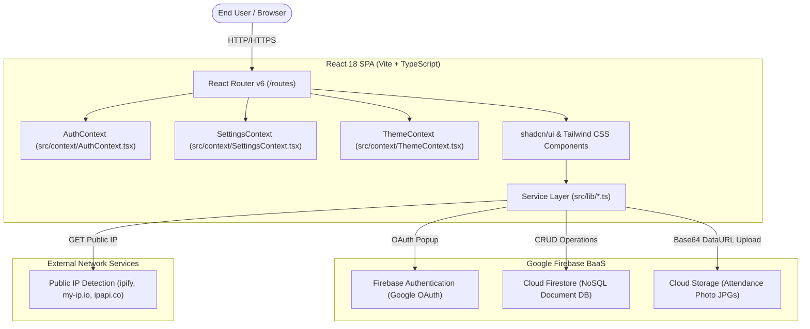
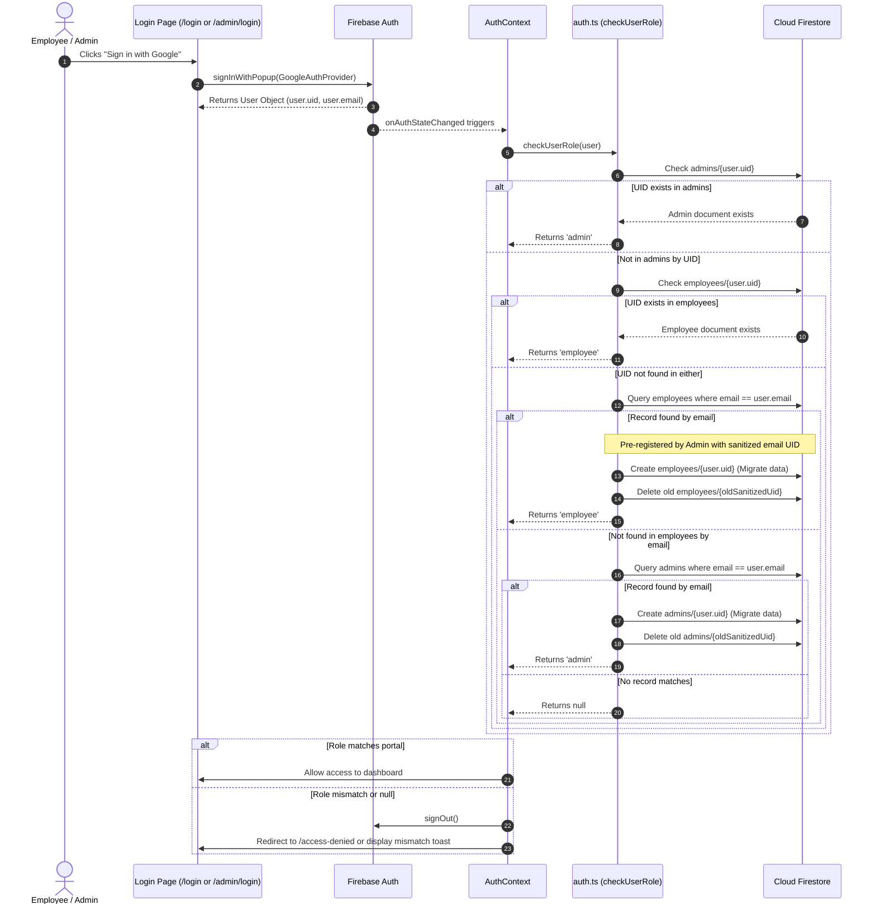
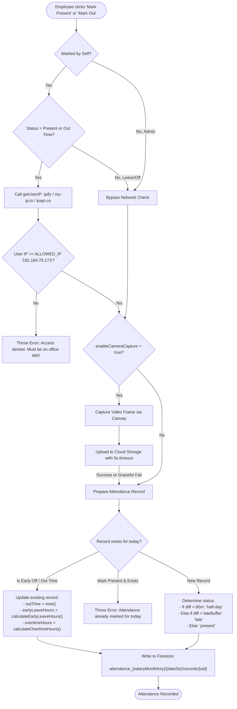

# ARCHITECTURE — ATTENDANCE PORTAL

## 1. System Topology Overview

The **Attendance Portal** is architected as a serverless Single Page Application (SPA) communicating directly with Google Firebase Backend-as-a-Service (BaaS) and external network IP services.



---

## 2. Component Relationships & Layering

The codebase follows a modular client-side layered architecture:

```
src/
├── main.tsx                      # DOM root mounting & React.StrictMode
├── App.tsx                       # Provider tree & Route configuration
├── components/
│   ├── auth/RequireAuth.tsx      # Route guard verifying user authentication & role
│   ├── ui/                       # Atomic UI widgets (Radix UI / Tailwind primitives)
│   └── ThemeToggle.tsx           # Light/Dark mode switcher
├── context/
│   ├── AuthContext.tsx           # Auth state listener, role resolution & profile
│   ├── SettingsContext.tsx       # System-wide operational settings & branding
│   └── ThemeContext.tsx          # LocalStorage-backed theme state (light/dark)
├── lib/
│   ├── firebase.ts               # Firebase App & SDK service initialization
│   ├── auth.ts                   # Google popup sign-in, sign-out, role migration
│   ├── firestore.ts              # Data access layer for Firestore operations
│   ├── salary.ts                 # Domain math: deductions, late status, hours
│   ├── holidays.ts               # Sundays generator & calendar utilities
│   ├── weekHolidays.ts           # Week-interval holiday filtering & formatting
│   ├── ipRestriction.ts          # Public IP detection & office WiFi validation
│   ├── storage.ts                # Base64 photo upload to Cloud Storage
│   └── utils.ts                  # Tailwind clsx + twMerge helper
├── routes/
│   ├── shared/                   # Public routes: Login, AdminLogin, AccessDenied
│   ├── employee/                 # Employee views: Dashboard, Calendar, Salary
│   └── admin/                    # Admin views: Dashboard, Employees, Attendance, etc.
└── types/index.ts                # TypeScript interfaces for entities & records
```

---

## 3. Authentication & Role Migration Pipeline

The application uses Google Sign-In with automated database record synchronization:



---

## 4. Attendance Marking & Processing Architecture



---

## 5. Database Access & Data Partitioning Patterns

Instead of storing all attendance records in a single monolithic collection with millions of rows, the architecture implements **Dynamic Root Partitioning**:
- Each salary billing cycle is assigned its own dedicated root collection:
  `attendance_{salaryMonthKey}` (e.g. `attendance_2025_12`).
- Each day within the cycle is stored as a document:
  `attendance_{salaryMonthKey}/{YYYY-MM-DD}`
- Individual attendance entries are stored in a nested subcollection:
  `attendance_{salaryMonthKey}/{YYYY-MM-DD}/records/{employeeUid}`

This partitioning ensures:
1. Fast parallel reads when rendering daily or monthly grids.
2. Natural historical archiving by month key.
3. High write concurrency across employees without document locking contention.

---

## 6. Architectural Constraints & Limitations
1. **Client-Side BaaS Model**: There is no custom backend service. All business rules and authorization policies executed in code are duplicated or must be secured by Firestore Security Rules.
2. **Synchronous Reporting Aggregation**: Monthly salary reports are computed on the client by fetching all daily attendance records in parallel for the month (`generateMonthlyReport` in `src/lib/firestore.ts:657`). For organizations with large numbers of employees, this causes high read volume.
3. **Hardcoded IP Constraint**: The authorized IP address (`182.184.79.173`) is hardcoded in `src/lib/ipRestriction.ts:6`, rather than loaded dynamically from Firestore settings.
